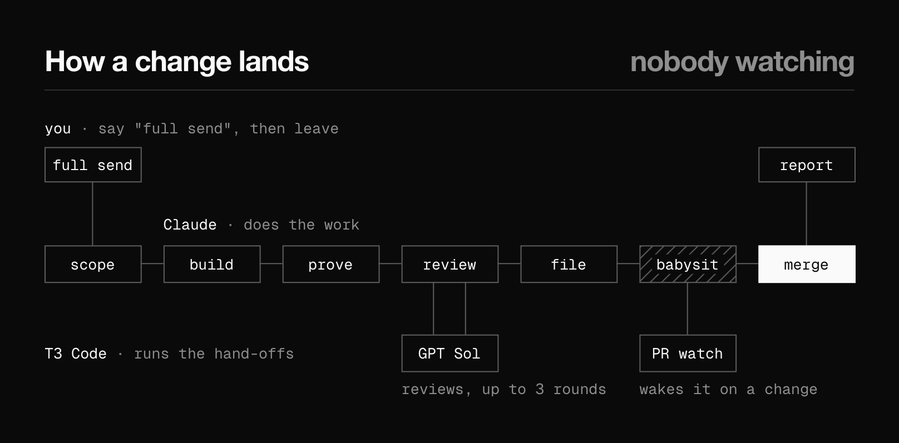

<div align="center">


# skills

**Take a ticket to a merged pull request with nobody watching.**

[](https://t3.codes)
[](#requirements)
[](#requirements)
[](#requirements)
[](./LICENSE)

[Requirements](#requirements) · [Skills](#skills) · [How it works](#how-it-works) · [Install](#install)

</div>

---

Say `full send` with a ticket link and walk away. Claude builds the smallest change, proves it in the real workflow, has GPT Sol review it, opens the PR, babysits the checks and merges. You come back to a report.

```text
> full send https://github.com/org/repo/issues/350

https://github.com/org/repo/pull/351  merged (4f2a91c)

Changed   Order sync no longer retries a payment that already went through
Proof     Reproduced the double charge on main, then watched the same checkout pass
Review    sol-loop, 2 rounds: 1 finding fixed, 2 nits declined
```

This is my live setup: the skills, global instructions and scripts I run Claude Code and Codex with.

## Requirements

- **T3 Code.** It is important to run this in [T3 Code](https://t3.codes). The skills start reviewers and wait on pull requests through T3's tools.
- **A Claude subscription and a Codex subscription.** Claude builds, GPT Sol reviews. Neither is swapped for another model.
- **macOS**, with `gh`, `jq` and `python3`.

`ws` appears in a few skills and is not included. It is a private wrapper that picks the right account for the folder I am in. Plain `gh` and `git` do the same job with one account.

## Skills

| Say this | Skill | What happens |
| --- | --- | --- |
| `full send` and a ticket | [full-send](claude/skills/full-send/SKILL.md) | The work goes to a merged PR. No comments, migrations or production |
| `full stop` | [full-stop](claude/skills/full-stop/SKILL.md) | The same, stopped with the PR ready for you to merge |
| `sol loop` | [sol-loop](claude/skills/sol-loop/SKILL.md) | GPT Sol reviews the change in rounds until both agents agree |
| `council` | [council](claude/skills/council/SKILL.md) | Three reviewers score the work out of ten |
| `catchup` | [catchup](claude/skills/catchup/SKILL.md) | A ranked, read-only briefing of what needs you |
| `hill climb` and a goal | [hill-climb](claude/skills/hill-climb/SKILL.md) | Small scored steps. Wins are kept, losses undone |
| `viz` | [viz](shared/skills/viz/SKILL.md) | A chart or diagram in black, gray and white |
| `draft a message to` | [writing](shared/skills/writing/SKILL.md) | Short, plain text that waits for your approval |

The first five need T3 Code and both subscriptions. [beam](shared/skills/beam/SKILL.md), [hook](shared/skills/hook/SKILL.md), [keep](shared/skills/keep/SKILL.md) and [reach](shared/skills/reach/SKILL.md) teach an agent to use my tools of the same names.

## pr-wait

[`bin/pr-wait`](bin/pr-wait) waits until a pull request changes in a way you asked about, then prints what changed. It covers the pull requests T3 can't read, such as Azure DevOps.

```console
$ pr-wait https://github.com/org/repo/pull/351 --on checks-done
CHANGED https://github.com/org/repo/pull/351
was: check CI / test: IN_PROGRESS
now: check CI / test: SUCCESS
```

`pr-wait --help` lists the events. It calls `ws gh` and `ws az`; swap those for `gh` and `az`.

## How it works



Claude works in a T3 Code thread. T3 starts the GPT Sol reviewer and wakes the thread when the PR changes, so nothing polls. [`global/CLAUDE.md`](global/CLAUDE.md) is the one file both agents read on every thread.

## Install

Each skill is a folder with a `SKILL.md`. `claude/` holds the skills only Claude runs, `codex/` the ones only Codex runs, and `shared/` the ones both use. Link the ones you want:

```sh
git clone https://github.com/Stoffberg/skills ~/skills
ln -s ~/skills/shared/skills/viz ~/.claude/skills/viz
ln -s ~/skills/shared/skills/viz ~/.codex/skills/viz
```

## License

[MIT](./LICENSE) © Dirk Beukes. Use anything here.

`hill-climb` builds on [Bil0000/Hill-Climb](https://github.com/Bil0000/Hill-Climb), also MIT, with its licence in the skill's folder. `writing` started from the unslop skill in [cursor/plugins](https://github.com/cursor/plugins).
